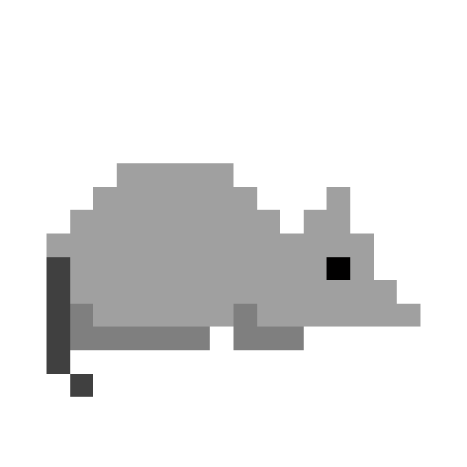

<div align="center">



# RAT (Radical Advanced Tools)

### A totally tubular, all-in-one Upscaler, Frame Generation, HDR & Shader Suite for SteamOS and Linux gaming systems.


</div>

---

RAT is a [Decky Loader](https://github.com/SteamDeckHomebrew/decky-loader) plugin that fetches, installs, tunes and cleans up DLSS / FSR / XeSS injectors (native or spoofed), OptiScaler frame generation, RenoDX HDR and ReShade, one game at a time, from Game Mode with the controller. It never touches SteamOS itself, needs no root, and puts every game file back the way it was when you remove something.

| Injector | What it does | GPUs | Proton |
|---|---|---|---|
| [**d4r**](https://github.com/countervolts/d4r) | NVIDIA's DLSS 3 / 4 / 4.5 networks running on AMD. Frame generation through RAT's FG fallback. | AMD RDNA3, RDNA4 | GE-Proton11-3 |
| [**HelixSR**](https://github.com/lonewolf0622/HelixSR) | The DLSS Model E network as D3D12 compute shaders (FSR 3.1 drop-in or HelixSR Scaler). RAT sticks to the 1.x releases | AMD RDNA1+, Steam Deck included; NVIDIA / Intel experimental | any current Proton |
| [**OptiScaler**](https://github.com/optiscaler/OptiScaler) | Swaps DLSS / FSR / XeSS inputs for DLSS, FSR 4, FSR 3.1, FSR 2 or XeSS, plus frame generation | any | GE-Proton 11, Proton-CachyOS, Proton Experimental |

GPU and Proton columns follow each author's own notes. On top of the injectors: **RenoDX** HDR from [clshortfuse/renodx](https://github.com/clshortfuse/renodx) and **ReShade** from [reshade.me](https://reshade.me).

> [!WARNING]
> Don't use injectors, ReShade's add-on build or RenoDX in online games with anti-cheat. RAT warns you when it spots anti-cheat, but it won't stop you.

## Contents

- [Requirements](#requirements)
- [Install](#install)
- [Quick start](#quick-start)
- [The panel](#the-panel)
- [Frame generation](#frame-generation)
- [Colour legend](#colour-legend)
- [What RAT downloads and writes](#what-rat-downloads-and-writes)
- [Troubleshooting](#troubleshooting)
- [Known limits](#known-limits)
- [Building from source](#building-from-source)
- [How it works](#how-it-works)
- [Credits](#credits)
- [License](#license)
- [Disclaimer](#disclaimer)

## Requirements

- SteamOS in Game Mode, or any Linux distro running Steam with [Decky Loader](https://github.com/SteamDeckHomebrew/decky-loader).
- A GPU your injector supports. RAT reads it and tells you before installing anything.
- The Proton build the injector's author recommends. Grab GE-Proton or Proton-CachyOS with ProtonUp-Qt or Wine Cellar in Desktop Mode; RAT switches the game to it with one button.
- Internet access for downloads.
- For HDR: an HDR display with HDR turned on in SteamOS (Settings → Display).

Developed on an AMD Radeon RX 9070 XT (MINISFORUM BD775i SE, Ryzen 7 7745HX) driving an LG C2 at 4K 120 Hz on stable SteamOS.

## Install

1. Install [Decky Loader](https://github.com/SteamDeckHomebrew/decky-loader).
2. Download `RAT-1.1.0.zip` from [Releases](https://github.com/berczeller/RAT/releases/latest) and copy it to the device. `SHA256SUMS.txt` next to it has its checksum.
3. Game Mode → **Decky → Settings → General** → enable **Developer mode**, then **Developer → Install plugin from ZIP file** and pick the zip.
4. Open the Quick Access menu (**···**) and pick the rat: **RAT (Radical Advanced Tools)**.

> [!NOTE]
> Decky needs the built zip (it contains `RAT/dist/index.js`). GitHub's "Source code" archives won't load.

## Quick start

1. Pick the game (the running one is preselected).
2. **UPSCALE**: pick an add-on, an upscaling mode and an upscaler, press **Inject**. Apply the launch options if RAT asks.
3. **FG**: slide to a frame generation method, set a base framerate cap, open **Latency & Anti-Lag** and press **Use recommended latency settings**, then **Save .ini**.
4. Start the game and select the upscaler (and frame generation, if the method needs it) in the game's own menu. The tips under each setting tell you exactly what to pick.

## The panel

The top shows the game picker, a one-line status (or the launch banner while the game runs) and four tabs. Each tab starts with the controls you reach for most:

| Tab | Shows |
|---|---|
| `[ UPSCALE ]` | add-on, upscaling mode, upscaler, Inject / Injection active / Update / Uninstall, and launch options when they need applying |
| `[ FG ]` | method, base framerate cap, then three folds: **Latency & Anti-Lag**, **How this method works**, **Advanced** |
| `[ LOOK ]` | two folds, **HDR · RenoDX** and **ReShade**: master switches, the Running now card, the active preset and its effects |
| `[ TUNE ]` | the injector settings most people change (sharpening, render resolution, upscaler model, overlay menu), then **Show advanced** |

**Show advanced** (end of TUNE, off by default) is for power users: every key of the injector's `.ini`, plus the advanced rows on the other tabs (add-on options, Proton and launch options, game profiles, preset tools, shader packages, compositor mode, RenoDX settings and auto-configuration) and the full status card. The gear opens **Settings**.

**Controls.** Short choices are notched sliders you move with the D-pad. Long lists (games, add-ons, upscalers, mods) open in a centred, colour-coded dialog with your current pick marked. Folds open one at a time. The focused control gets a white outline, and a quick amber pulse confirms each press.

The sections below list everything, with Show advanced on.

### Upscale

- **Add-on**: d4r, HelixSR, OptiScaler, or **+ ADD FORK** from a link or a `.zip` / `.7z` on a drive. Downloads come from official GitHub releases and are checksum-verified when the release publishes one.
- **Upscaling mode**: *Native DLSS* (a real DLSS network: NVIDIA RTX, d4r on RDNA3 / 4, HelixSR's Model E), *Spoofed → FSR* or *Spoofed → XeSS* (the game sees an NVIDIA GPU, offers DLSS, and the injector answers with FSR or XeSS). OptiScaler's native DLSS only shows up on NVIDIA RTX.
- **Upscaler**: DLSS 4 (K), DLSS 4.5 (M, L), DLSS 3 CNN (E, F), FSR 4, FSR 3.1, FSR 2.2, XeSS, HelixSR Model E, or *None* to switch injection off without uninstalling.
- **Add-on options**: injection DLL name, spoofing, RCAS sharpening (on by default), fakenvapi and friends, as toggles and notched sliders. Every add-on installs with its startup splash shown; change it on TUNE (Show advanced) and your choice sticks across reinstalls.
- **External injector found?** A red card lists OptiScaler copied by hand, a manual d4r, HelixSR, fakenvapi or Nukem's dlssg-to-fsr3. **Remove & wipe** clears it, **Verify game files in Steam** fixes whatever it broke.
- **Proton & launch options**: RAT merges its variables into yours (`gamemoderun`, `mangohud` and your own stay), cleans duplicates, and offers the recommended Proton. **Preserve Swapchain Image Count** pins vkd3d-proton to 3 images for games that pace badly with FG.
- **Game profile**: copy, paste, export, import, delete, or **Apply from another game**.

Once installed: **Injection active** toggles it without removing files, **Update / Reinstall / Repair** keep your `.ini`, **Uninstall** restores the game (ReShade and HDR stay until you remove them on their folds).

**Uninstalling and launch options.** Removing the injector, ReShade or RenoDX asks what to do with the game's launch arguments when the removal would change them: **Uninstall & restore launch options** puts them back as they were before RAT, **Uninstall & keep them** leaves them as they are. Only the selected game changes. RAT remembers variables you had before it needed them (`PROTON_ENABLE_HDR`, `DXVK_HDR`, your own DLL overrides) and never removes those, so native HDR keeps working after ReShade or RenoDX goes. Removing RenoDX also takes its sections out of a `ReShade.ini` that stays.

### Tune

The essentials first, as toggles and notched sliders: **Sharpening** (RCAS / CAS), **Render resolution** (ratio override, output scaling), **Upscaler model** (DLSS preset, FSR 4 model) and **Overlay menu** (key, scale, FPS, splash), or d4r's model and watermark. Only keys the installed `.ini` has are listed.

With **Show advanced** on: every key of the injector's own `.ini` (`OptiScaler.ini`, `d4r.ini`, `helixsr.ini`, `fakenvapi.ini`), grouped in collapsible sections. Controls are built from the authors' comments; **What does this do?** shows the full comment and **Custom value** takes free input. Changes are staged and written with **Save .ini** while the game is closed, and they survive closing the Quick Access menu.

### HDR · RenoDX

- **Official RenoDX mods** matched by app id and title, **community forks** from the RenoDX wiki, **auto profiles** by engine (Unreal 4 / 5, Unity, Source, generic DX11 / DX12) when there's no game mod, any other game's mod, or a custom mod from a link or file.
- **RenoDX and ReShade are one package.** Enabling HDR always downloads, verifies and links ReShade's add-on build (a DLL a game update or file verification removed gets put back). Installing ReShade puts RenoDX back next to it when the game has it, and installs it when a pasted or imported profile asks for HDR. Both land next to the game's real executable: on Unreal that's `<Project>/Binaries/Win64` (or `WinGDK`), never the bootstrapper in the install root, and setups left in the wrong folder are moved.
- The HDR launch variables (`DXVK_HDR=1`, `PROTON_ENABLE_HDR=1`, `ENABLE_HDR_WSI=1`, `ENABLE_GAMESCOPE_WSI=1`) come and go with the mod.
- **Auto-configuration** (the black-screen fix): RAT parses the mod's notes from RenoDX's index and wiki (resource upgrades like `R10G10B10A2_UNORM → Output size`, scRGB, borderless, copy destinations), detects the engine and version, graphics API (live while the game runs), the game's own HDR and fullscreen settings (Unreal's `GameUserSettings.ini` in the Proton prefix) and whether OptiScaler or frame generation sits in front of ReShade, then writes:

  | Setting | Value | Why |
  |---|---|---|
  | Settings Mode | Advanced | swap chain and resource upgrades visible |
  | Force Borderless, Prevent Fullscreen | Enabled | exclusive fullscreen goes black under Proton / gamescope |
  | Swap chain format / encoding | HDR10 | what gamescope presents directly |
  | Swap Chain Compatibility Mode | On with OptiScaler, d4r or FG | lets them read the swap chain |
  | Peak / game / UI brightness | display peak, 203, 203 | HDR reference white |
  | Resource upgrades (auto / generic profiles) | Unreal: `R10G10B10A2_UNORM` Output size · Unity: `R11G11B10_FLOAT`, `R8G8B8A8_TYPELESS` · generic DX11 / 12: `R8G8B8A8_TYPELESS`, `R10G10B10A2_UNORM` | the intermediates the engine renders to before the swap chain |

  Game-specific mods keep the upgrades their maintainers put in code; only what their notes ask for is added. Values you change in RenoDX's menu are kept; **Re-detect & apply** refreshes, **Reset to detected configuration** overwrites. Advice RAT can't apply (turn off in-game HDR, switch to Windowed Fullscreen, avoid Vulkan) shows as warnings.
- Every numeric RenoDX setting as a slider or toggle, **SAVE TO .INI** / **LOAD .INI…** (`~/RAT/renodx`), and a **RenoDX enabled** master switch. They stay editable while the game runs; RenoDX reads them when the game loads it, so changes land at the next start.

### ReShade

- Official ReShade from reshade.me (latest, 6.8.0 or 6.7.3, with or without add-on support), loaded as `dxgi.dll`, `d3d9.dll`, `d3d8.dll` or `opengl32.dll`. When OptiScaler already owns `dxgi.dll`, ReShade becomes `ReShade64.dll` and OptiScaler loads it.
- Shader packages from ReShade's official list only, presets (new, copy, delete, export, import, library), per-effect **Parameters** with **SAVE DEFAULT** / **RESTORE DEFAULT**.
- **ReShade enabled** master switch, and **Compositor mode** (one effect through gamescope, no injection) for Vulkan games.
- **Live while you play**: effect toggles and shader parameters apply in the running game. RAT binds F24 as a ReShade preset shortcut and taps it through a virtual keyboard, which makes ReShade re-read the preset. Switching to another preset applies at the next start.
- **Running now** card (the ReShade and HDR folds, and the launch banner): whether ReShade and RenoDX are really loaded in the game, read from the game's process and `ReShade.log`, plus the overlay key.
- With an OptiScaler-based injector (OptiScaler, d4r, HelixSR Scaler) ReShade is loaded by OptiScaler: RAT writes `LoadReshade=true` even when the add-on's `.ini` doesn't list it (d4r), turns on OptiScaler's D3D12-device-first hotfix when RenoDX is installed, and moves OptiScaler's menu key off ReShade's overlay key if they clash.

### Settings

| Setting | What it does |
|---|---|
| Show contextual hints | Short explanations under every setting. Off for a compact panel; warnings always show. |
| Boot banner & status HUD | A RAT notification when a managed game starts, showing what runs. |
| Set launch options automatically | RAT writes the variables and DLL overrides it needs after every change. |
| Allow unsupported GPUs | Installs even when the GPU isn't on the author's list. |
| Include pre-releases | Offers pre-release injector builds. |
| HDR display peak brightness | Prefills RenoDX. 0 = automatic (1000 nits). |

Settings also holds the executable folder override, update checks, fork removal, non-Steam game folders, a library rescan and About.

## Frame generation

### Methods

Each method sets OptiScaler's FG input and output together. Pick one and RAT shows what it does, which games and GPUs it works with, what needs spoofing, and the steps in the game.

| Method | Use it when | In the game |
|---|---|---|
| **OptiFG → FSR FG** | The game has no FG of its own. Start here. | Pick DLSS / FSR / XeSS as the upscaler, leave game FG off |
| **Game FSR 3.1 FG → FSR FG** | The game ships FSR 3.1 frame generation | Turn on the game's FSR FG |
| **Game DLSS FG → FSR FG** | The game ships DLSS Frame Generation | Reflex on, then DLSS FG on |
| **Game DLSS FG → FSR FG (Nvngx)** | Same, but the previous one stutters | Reflex on, then DLSS FG on |
| **Game DLSS FG → Nukem's dlssg-to-fsr3** | You prefer Nukem's pacing (you supply its DLL) | Reflex on, then DLSS FG on |
| **OptiFG → XeFG** | Intel Arc, or you want to compare pacing | Pick an upscaler, leave game FG off |
| **Game XeFG → FSR FG** | The game ships XeSS frame generation | Turn on the game's XeSS FG |

**Spoofing**, in short: OptiFG and the FSR / XeSS input methods need none. The *Game DLSS FG* methods need the game to think it runs on NVIDIA with Reflex, so on AMD and Intel keep DXGI and Streamline spoofing on and install fakenvapi (Upscale tab). NVIDIA cards need nothing extra.

**OptiFG → XeFG** on Unreal: when OptiScaler says XeFG requires disabling (dilated) motion vectors, RAT already writes `r.NGX.DLSS.DilateMotionVectors=0` to the game's `Engine.ini` in the Proton prefix when you save, and takes it out when you switch method or uninstall. XeFG output also forces borderless (it doesn't run in exclusive fullscreen). On other engines, use FSR or XeSS as the in-game upscaler, or OptiFG → FSR FG.

A method marked **FILES MISSING** needs libraries your injector doesn't ship; **GAME LACKS IT** means the game doesn't seem to have the FG it hooks into.

### Base framerate cap

A slider (whole frames, 0 = off) plus quick presets, right in the FG block. It caps the frames the game *renders*, before frame generation, so every real frame lands on an even beat: flatter frame times, better pacing, less lag. Rule of thumb with 2× FG: half your refresh rate (60 for 120 Hz).

OptiScaler's own `FramerateLimit` counts *shown* frames, so RAT writes `cap × FG multiplier` (×2 for FSR FG, ×(1 + interpolated frames) for XeFG) and keeps your base cap when you switch methods.

### Latency & Anti-Lag

FG holds a frame back; a latency reducer wins it back. RAT works out which one actually runs for your GPU, add-on and method, shows only the settings that apply, and offers **Use recommended latency settings**.

| Setup | Latency reducer | Recommended |
|---|---|---|
| NVIDIA | Native Reflex via Proton's dxvk-nvapi | Reflex on in game, 1 frame ahead |
| AMD + fakenvapi | Anti-Lag (Vulkan) when Mesa offers it, else LatencyFlex | Force Reflex on, LatencyFlex conservative, 1 frame ahead |
| AMD / Intel + fakenvapi, game FSR FG | LatencyFlex (forced; Anti-Lag can't drive it) | Force LatencyFlex on |
| Intel + fakenvapi, or any XeFG output | XeLL | Force Reflex on |
| AMD / Intel without fakenvapi | none | Install fakenvapi on the Upscale tab |
| d4r | Proton's dxvk-nvapi (d4r needs it for DLSS) | Base framerate cap + 1 frame ahead |

Anti-Lag 2 itself is Windows-only; on Linux fakenvapi uses Vulkan Anti-Lag or LatencyFlex instead.

### d4r FG fallback

d4r bundles OptiScaler (0.9.4 today) without its frame generation libraries. The **FG fallback** card on the FG tab reads which OptiScaler build d4r ships (DLL version, readme or OptiScaler log; only real 0.x OptiScaler numbers count, anything else falls back to the documented 0.9.4), then takes the libraries from the first source that has them:

1. a stored OptiScaler package of the same build or line (works offline);
2. the official OptiScaler release for that line on GitHub, or the pinned [v0.9.4 release](https://github.com/optiscaler/OptiScaler/releases/tag/v0.9.4) when the line has none;
3. any OptiScaler or HelixSR add-on you've already downloaded or imported (the log notes the version difference).

It copies only the libraries you pick into d4r's library folder, each group from one folder so the FFX loader and its FG DLL always match:

- **FSR frame generation**: the AMD FidelityFX FG libraries. Unlocks OptiFG → FSR FG and the game-input methods.
- **XeFG + XeLL**: Intel's frame generation and latency libraries. Unlocks OptiFG → XeFG.

Nothing d4r ships is ever replaced, fakenvapi is never borrowed (d4r needs dxvk-nvapi), the files survive Reinstall / Update, and **Remove fallback files** or Uninstall takes them out again.

## Colour legend

| Colour | Meaning |
|---|---|
| Green | DLSS: real DLSS, d4r's DLSS networks, HelixSR's Model E |
| Coral | AMD FSR |
| Azure | Intel XeSS |
| Violet, gold edge | Forks and community additions (imported forks, Nukem's FG, ReShade presets and effects) |
| Grey | Auto, None, Off, plain choices |

In the HDR fold: green = official RenoDX mod, violet = community fork, azure = auto profile, coral = custom mod.

## What RAT downloads and writes

**Downloads**, only when you use the feature and always from the official source:

| What | From |
|---|---|
| Injector releases | Each injector's or fork's GitHub releases |
| OptiScaler FG libraries for d4r | See [d4r FG fallback](#d4r-fg-fallback) |
| ReShade | reshade.me (SHA-256 checked for 6.8.0) |
| d3dcompiler_47.dll | Mozilla's Firefox 62.0.3 installer (SHA-256 pinned) |
| Shader packages | ReShade's official list, then each author's repository |
| RenoDX mods and index | renodx.com, RenoDX's GitHub releases and wiki, and the mod's own host |

**Outside game folders:**

| Path | What |
|---|---|
| Decky's `settings/RAT` and `data/RAT` | Settings, downloaded packages, ReShade binaries and shaders, shader defaults, RenoDX mods, caches |
| `~/RAT/profiles`, `~/RAT/presets`, `~/RAT/renodx` | Exported profiles, ReShade presets, RenoDX settings |
| `~/.local/share/gamescope/reshade` | Shaders for compositor mode |

**In game folders**, everything RAT adds is recorded in a `.rat` folder next to the game's `.exe` (`record.json`, `reshade.json`, `renodx.json`, plus backups of replaced files) and removed by the matching Uninstall / Remove button.

## Troubleshooting

| Problem | Try this |
|---|---|
| OptiScaler's menu (Insert) never shows | Upscale tab → **Injection DLL name** `winmm.dll` or `version.dll`, then Reinstall |
| DLSS doesn't show up in the game on AMD / Intel | Use a spoofed mode, or turn on **Force NVAPI**. With d4r use GE-Proton11-3 |
| First d4r start freezes for a minute | Normal: DLSS kernels compile once and are cached in `~/.cache/d4r` |
| HelixSR's network build fails (Compile step) | It downloads NVIDIA's DLSS files once: check the network and free space and press Inject again. If an older HelixSR was built before, RAT keeps using it. HelixSR 2.x isn't used: its setup pulls NVIDIA's whole driver package and stalls without a game folder, so RAT stays on 1.x and clears any stored 2.x copy |
| Status says "files missing" | A game update or file verification replaced the injector. Press **Repair** |
| FG method says FILES MISSING with d4r | Add that group in the **FG fallback** card |
| FG fallback can't find the files | Get online once, or download OptiScaler on the Upscale tab, or import an OptiScaler 0.9.x archive with **+ Add fork**, then press the button again |
| DLSS FG toggle stays greyed out on AMD / Intel | Install fakenvapi, keep DXGI + Streamline spoofing on, enable Reflex in the game |
| FG feels laggy | **Use recommended latency settings**, set a base framerate cap, keep 1 frame ahead |
| FG paces badly or the game won't start | Base framerate cap at half your refresh rate; try **Preserve Swapchain Image Count** |
| HDR settings show "paused" | ReShade is off on the ReShade fold; RenoDX runs inside ReShade |
| Native HDR gone after removing ReShade or RenoDX | The game needs `PROTON_ENABLE_HDR=1` (and `DXVK_HDR=1` on DX11 / DXVK) in its launch options. A build before this one could remove them on uninstall; add them back once and RAT keeps them from now on, or pick **keep them** in the uninstall dialog |
| Black screen with RenoDX | LOOK → HDR fold → **Re-detect & apply**, then **Reset to detected configuration** if you changed upgrades; switch the game to Windowed Fullscreen; check the warnings under Auto-configuration |
| RenoDX loads but ReShade doesn't (or the other way round) | Press **Reinstall HDR**: it re-links both next to the game's real executable |
| ReShade doesn't load | Pick ReShade 6.7.3 and reinstall; Vulkan games need Compositor mode |
| ReShade's overlay key does nothing (d4r, OptiScaler) | Check the **Running now** card. If ReShade isn't loaded, close the game and press **Reinstall ReShade** (or Reinstall HDR): RAT re-links it and fixes OptiScaler's `LoadReshade` and menu key |
| A ReShade change doesn't show in game | It applies live through the F24 preset shortcut; if the toast says "next start", another preset was loaded at launch or the virtual keyboard isn't available |
| OptiScaler says XeFG requires disabling motion vectors | Save the method once more (Unreal), restart the game; elsewhere use FSR / XeSS as the in-game upscaler |
| HDR looks washed out or dark | HDR on in SteamOS, peak brightness set to your display's, check the mod's notes |
| Saved settings were reset | OptiScaler's own overlay rewrote `OptiScaler.ini`. Use TUNE, or Reinstall |

Logs go to Decky's plugin log. **View .ini files & logs** on the Upscale tab shows the injector's and ReShade's files.

## Known limits

- **d4r** runs native DLSS only (no spoofed modes).
- **Nukem's dlssg-to-fsr3** isn't downloaded by RAT; drop its DLL next to the game's `.exe` yourself.
- **RenoDX and ReShade's DLL proxy** can't load in Vulkan games under Proton. Compositor mode works there, one effect, no depth buffer.
- **Shader parameters** come from the shader's annotations. Uniforms ReShade drives itself (timers, keys, depth) and hidden ones aren't listed.
- **Launch detection**, the banner and the boot HUD rely on Steam client events in Game Mode. Non-Steam games are matched by folder and get no boot HUD.
- **The base framerate cap** goes through OptiScaler's limiter, so it needs an OptiScaler build with `[Framerate] FramerateLimit` (0.9 and newer).

## Building from source

Node 18+, pnpm and Python 3.11+.

```sh
pnpm install
pnpm build            # dist/index.js
pnpm typecheck
pnpm test             # backend tests: fake Steam library, no network
./scripts/package.sh  # -> out/RAT-1.1.0.zip (fetches 7-Zip into bin/ if missing)
```

Integration tests with real release archives: `RAT_REAL_DIR=/path/with/archives pnpm test` (looks for `Optiscaler_*.7z`, `d4r-*.zip`, `HelixSR-*.zip`).

## How it works

```
main.py                     Decky backend entry (async wrappers)
py_modules/rat/
  addons.py                 catalog: sources, GPU / Proton recommendations, upscalers, paths, options
  installer.py              per-game install, update, activate, modes, settings editor, launch options, status
  framegen.py               FG methods and guides, base framerate cap, latency plans, file checks
  d4rfg.py                  d4r FG fallback: bundled-build detection, donor release, library placement
  reshade.py                ReShade binaries, shader packages, proxy and chaining, presets, parameters, compositor
  renodx.py                 RenoDX index and wiki matching, auto profiles, any-game mods, settings, HDR variables,
                            the ReShade <-> RenoDX dependency
  renodx_auto.py            RenoDX auto-configuration: profile note parsing, pipeline detection, engine rules
  liveinput.py              virtual keyboard (uinput) that makes ReShade apply edits live
  ueconfig.py               Unreal Engine.ini fixes in the Proton prefix (XeFG motion vectors)
  profiles.py               copy / paste / apply from another game / export / import / delete
  peinfo.py                 PE imports, engine and graphics API detection, running API
  inischema.py              turns INI comments into controller-friendly fields
  external.py               finds and removes injectors RAT didn't install
  sources.py                GitHub releases, links, local archives, safe extraction, cached indexes
  helix_bridge.py           drives HelixSR's own installer without prompts
  steam.py, vdf.py, gpu.py  library discovery, VDF parsing, GPU detection (AMD / NVIDIA / Intel)
  ini.py, launchopts.py     comment-preserving INI edits, launch option merging and cleanup
  jobs.py, records.py       staged background jobs, per-game records
src/
  index.tsx                 the panel: header, game picker, status, four tabs, Settings
  tabs/                     inject, framegen, look (HDR + ReShade folds), hdr, reshade, tune, settings
  picker.tsx                centred, colour-coded choice dialogs (every list in RAT)
  feedback.ts               press pulse for controller, keyboard, mouse and touch
  progress.tsx, hud.tsx     progress modal, boot HUD and launch banner
  theme.tsx, upscaler.tsx   palette, focus / press styles, mode and upscaler pickers
  controls.tsx, modals.tsx  INI controls, staged edits, dialogs
assets/rat.svg              the icon
bin/7zz                     7-Zip (static) for .7z releases and installers
```

- `.ini` files are edited line by line, so comments, order and line endings stay as the authors wrote them.
- Launch options and Proton versions go through the running Steam client, never by editing Steam's files.
- Every file an injector replaces is backed up and put back on uninstall; a file a later game patch updated is kept instead.

## Credits

**Author:** Tom Berczeller

**Downloaded at runtime from their official sources, under their own licenses:**

- [d4r](https://github.com/countervolts/d4r) by countervolts
- [HelixSR](https://github.com/lonewolf0622/HelixSR) by lonewolf0622 (Lone Wolf)
- [OptiScaler](https://github.com/optiscaler/OptiScaler) by cdozdil and the OptiScaler contributors (also the source of d4r's FG fallback libraries)
- [ReShade](https://reshade.me) by crosire, and the shader packages on ReShade's official list by their authors
- [RenoDX](https://github.com/clshortfuse/renodx) by Carlos Lopez Jr. (clshortfuse) and the RenoDX mod authors
- fakenvapi, Nukem's dlssg-to-fsr3 and DLSS Enabler are recognised so they can be configured or removed; credit to their authors

**Bundled or built with:**

- Icon: [Rat Vector SVG Icon (30)](https://www.svgrepo.com/svg/417294/rat) by [Thiago](https://www.svgrepo.com/author/Thiago/), from [SVG Repo](https://www.svgrepo.com/), under the [CC Attribution License](https://www.svgrepo.com/page/licensing/#CC%20Attribution). `assets/rat.svg` is the unmodified file; the sidebar icon (`src/icon.tsx`) recolours it to the theme and crops it to the rat.
- [7-Zip](https://www.7-zip.org/) by Igor Pavlov (`bin/7zz`)
- [Decky Loader](https://github.com/SteamDeckHomebrew/decky-loader) and its plugin template by Steam Deck Homebrew
- [react-icons](https://github.com/react-icons/react-icons) (Feather icons)

## License

RAT is released under the [BSD 3-Clause License](LICENSE), © 2026 Tom Berczeller, based on the Decky plugin template (BSD 3-Clause, © Steam Deck Homebrew).

The icon (CC Attribution) and `bin/7zz` (GNU LGPL with the unRAR restriction, see `bin/7zz-License.txt`) keep their own licenses; see [Credits](#credits).

Nothing RAT downloads is part of this repository, and each keeps its own license: d4r is GPL-3.0 and bundles NVIDIA files under NVIDIA's terms; OptiScaler is GPL-3.0 and bundles AMD FidelityFX and Intel XeSS under their licenses; HelixSR uses the HelixSR Freeware License; ReShade is BSD-3-Clause and is downloaded from reshade.me as its author asks; RenoDX is MIT.

## Disclaimer

RAT (Radical Advanced Tools) is an independent, unofficial project, not affiliated with, endorsed by or sponsored by AMD, Valve, NVIDIA or Intel, nor by the authors of d4r, HelixSR, OptiScaler, ReShade or RenoDX.

- AMD, Radeon, FSR and FidelityFX are trademarks of Advanced Micro Devices, Inc. NVIDIA, DLSS and Reflex are trademarks of NVIDIA Corporation. Intel, XeSS and XeLL are trademarks of Intel Corporation. Steam and SteamOS are trademarks of Valve Corporation. They're used here only to describe compatibility.
- Injecting DLLs, ReShade's add-on build and RenoDX can break games and get accounts banned (see the warning at the top).
- Remove & wipe deletes files in game folders. It only deletes what it can identify as injector files, but keep "Verify game files in Steam" in mind.
- Use at your own risk. The software is provided "as is", without warranty of any kind.
